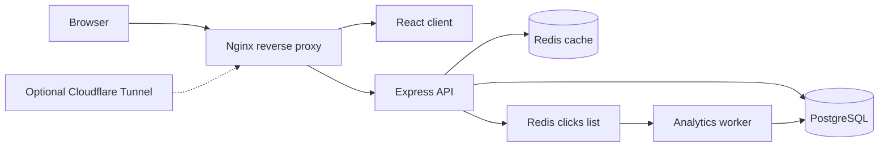

# URLite

A service-oriented URL shortener built around a small, understandable backend stack: Express, PostgreSQL, Redis, a separate analytics worker, and an Nginx entry point.

## Architecture



| Component | Responsibility | Technology |
|---|---|---|
| Web client | URL creation and analytics UI | React |
| Reverse proxy | Single entry point for web and API traffic | Nginx |
| API | Short-code creation, redirects and stats | Node.js, Express |
| Persistent store | URL records and click counts | PostgreSQL |
| Cache / queue | Redirect lookup cache and click-event handoff | Redis |
| Worker | Applies click-count updates outside the redirect handler | Node.js |

## Engineering notes

- Redirect lookups use Redis as a cache in front of PostgreSQL.
- Cached URLs have a one-hour TTL.
- Click events are pushed to a Redis list and processed by a separate worker, keeping the database update out of the main redirect path.
- The current Redis-list worker is intentionally simple; it is not a durable message-processing system. A production deployment would need explicit retry, idempotency and dead-letter handling.
- Cloudflare Tunnel support is optional and enabled through a Compose profile. Its token is supplied through an environment variable, never committed as configuration.

## Run locally

### Prerequisites

- Docker Engine
- Docker Compose

### Configure

```bash
git clone https://github.com/SSRINIBASS/urlite.git
cd urlite
cp .env.example .env
```

Edit `.env` and set a strong `POSTGRES_PASSWORD`. Keep the password in `DATABASE_URL` consistent with it.

### Start the stack

```bash
docker compose up --build -d
```

Open [http://localhost:8080](http://localhost:8080).

To enable the optional Cloudflare Tunnel, set `TUNNEL_TOKEN` in your local `.env` and run:

```bash
docker compose --profile tunnel up --build -d
```

## Repository layout

```text
client/       React application
server/       Express API
worker/       Redis click-event worker
nginx/        Reverse-proxy configuration
Database/     PostgreSQL initialisation SQL
docker-compose.yml
.env.example
```

## Current scope

URLite demonstrates service decomposition, cache-backed reads, background work, relational persistence and containerised local deployment. It is a compact engineering project, not a claim of production-scale capacity or delivery guarantees.

## License

See [LICENSE](LICENSE) if present in the repository.
